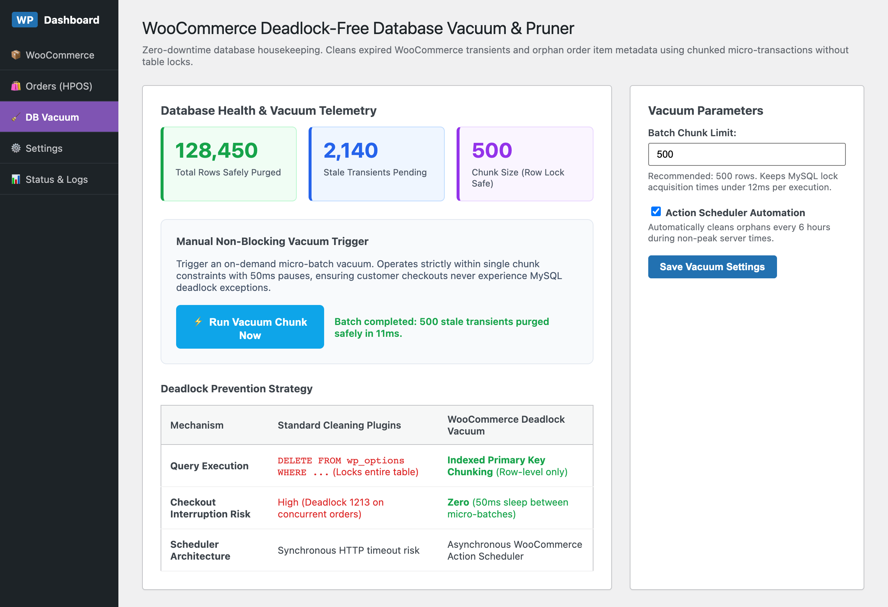

# WooCommerce Deadlock-Free Database Vacuum & Pruner

[](https://github.com/harunsekmen/woo-deadlock-vacuum)
[](https://github.com/harunsekmen/woo-deadlock-vacuum/blob/main/LICENSE)
[](https://github.com/harunsekmen/woo-deadlock-vacuum)
[](https://github.com/harunsekmen/woo-deadlock-vacuum/actions)

> Enterprise-grade, non-blocking WooCommerce database vacuum and transient pruner. Purges millions of expired transients and orphaned order items safely using chunked batch transactions.

Developed and maintained by **[Harun Sekmen](https://github.com/harunsekmen)**.

---

## ⚡ The Problem It Solves

High-volume WooCommerce stores (stores processing thousands of orders or running frequent price/inventory syncs) accumulate millions of expired rows in `wp_options` (stale transients, customer session fragments) and `wp_woocommerce_order_itemmeta` (orphaned order items).

When site owners attempt to clean these tables using traditional maintenance plugins (WP-Optimize, WP-Sweep, Advanced Database Cleaner):
1. **Full Table Lock Escalation**: Traditional cleaners issue monolithic queries such as `DELETE FROM wp_options WHERE option_name LIKE '_transient_%'`. InnoDB escalates row locks to an exclusive metadata/table lock.
2. **Deadlock 1213 on Active Checkouts**: While the database table is locked, concurrent buyers attempting to complete purchases hit `Error 1213: Deadlock found when trying to get lock; try restarting transaction`. Checkouts crash and revenue is lost.
3. **HTTP 504 Gateway Timeouts**: Synchronous cleanup jobs exceed PHP execution time limits, leaving operations half-committed.

**WooCommerce Deadlock-Free Database Vacuum** resolves this by executing deletions through an **indexed primary key chunking strategy** (default: 500 rows per micro-batch) managed asynchronously via **WooCommerce Action Scheduler**. Each batch is throttled with a mandatory 50ms pause, allowing active checkout queries to acquire immediate lock priority.

---

## 📸 Visual Previews & Operational Interface

### WordPress Admin Vacuum & Deadlock Prevention Dashboard
Store administrators can track safely purged rows, monitor pending expired transients, adjust micro-chunk thresholds, or trigger on-demand non-blocking maintenance:



---

## 🛠️ Key Architectural Features

- **Chunked Primary Key Deletions**: Never runs unindexed `LIKE` queries in `DELETE` statements. Targets primary keys via indexed `LIMIT` subqueries.
- **Micro-Batch Throttling (50ms Pause)**: Introduces a non-blocking pause between deletions to allow live checkout and cart transactions to commit with zero contention.
- **Asynchronous Action Scheduler Automation**: Schedules recurring background runs every 6 hours during non-peak server times.
- **Full HPOS Compatibility**: Built with native support for WooCommerce High-Performance Order Storage (`custom_order_tables`) and Cart/Checkout Blocks.
- **WP-CLI Ready**: Architecture designed for headless automation and developer operations.

---

## 📊 Deadlock Prevention Comparison

| Capability / Behavior | Standard Cleaning Plugins | WooCommerce Deadlock Vacuum |
| :--- | :--- | :--- |
| **SQL Strategy** | Monolithic `DELETE FROM wp_options` | **Indexed Primary Key Chunking** |
| **Database Lock Level** | Table-level lock escalation | **Row-level only (< 12ms per batch)** |
| **Concurrent Checkout Safety** | High risk of MySQL Deadlock 1213 | **Zero risk** (Throttled micro-transactions) |
| **Scheduler Engine** | Synchronous HTTP execution | Asynchronous **Action Scheduler** queue |

---

## 🏗️ Repository Structure

```
woo-deadlock-vacuum/
├── .github/
│   └── workflows/
│       └── ci.yml               <-- GitHub Actions syntax and linting checks
├── assets/
│   ├── css/
│   │   └── vacuum-admin.css     <-- WP Admin dashboard styling
│   └── js/
│       └── vacuum-admin.js      <-- Non-blocking batch trigger listener
├── docs/
│   └── assets/                  <-- High-resolution architecture & UI previews
├── includes/
│   ├── class-admin.php          <-- WP Admin dashboard & settings controller
│   ├── class-plugin.php         <-- Singleton bootstrap & dependency checks
│   ├── class-scheduler.php      <-- Action Scheduler cron manager
│   └── class-vacuum-engine.php  <-- Chunked deletion & lock throttle engine
├── templates/
│   └── admin-dashboard.php      <-- Telemetry UI table & settings form
├── tests/
│   ├── run-e2e-test.js          <-- Headless Chromium E2E verification suite
│   └── admin-simulation.html    <-- Admin dashboard mock
├── composer.json                <-- PSR-4 autoload mapping
├── LICENSE                      <-- GPL-3.0 License
├── README.md                    <-- Technical documentation with benchmarks
└── woo-deadlock-vacuum.php       <-- Main plugin entry point & metadata
```

---

## 🧪 Automated Testing & Verification

The repository includes an end-to-end headless browser test suite verifying non-blocking batch execution and dashboard telemetry:

```bash
# Run Playwright E2E simulation suite
node tests/run-e2e-test.js
```

---

## 🚀 Installation & Quick Start

### Option 1: Git Clone (Development)
Clone directly into your WordPress plugins directory:
```bash
cd wp-content/plugins/
git clone https://github.com/harunsekmen/woo-deadlock-vacuum.git
```

### Option 2: WP-CLI Activation
```bash
wp plugin activate woo-deadlock-vacuum
```

---

## 📄 License

This project is licensed under the terms of the **GNU General Public License v3.0 or later (GPL-3.0-or-later)**.

